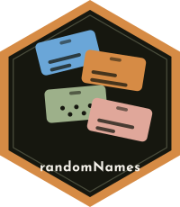

## Description

{style="float: right" width="120"}

Generates gender and ethnicity correct first and/or last names. Names are chosen proportionally based upon their probability of appearing in a large scale data base of real names, so a roster of random names looks like a roster of real ones. Useful for anonymising results that would otherwise identify people.

## See Also

Useful links:

-   <https://centerforassessment.github.io/randomNames/>

-   <https://github.com/CenterForAssessment/randomNames/>

-   <https://cran.r-project.org/package=randomNames>

-   Report bugs at <https://github.com/CenterForAssessment/randomNames/issues/>

## Author(s)

**Maintainer**: Damian W. Betebenner <dbetebenner@nciea.org> ([ORCID](https://orcid.org/0000-0003-0476-5599))

Authors:

-   Damian W. Betebenner <dbetebenner@nciea.org> ([ORCID](https://orcid.org/0000-0003-0476-5599))

Other contributors:

-   Lambert Joshua \[contributor\]

-   Center for Assessment \[copyright holder\]

